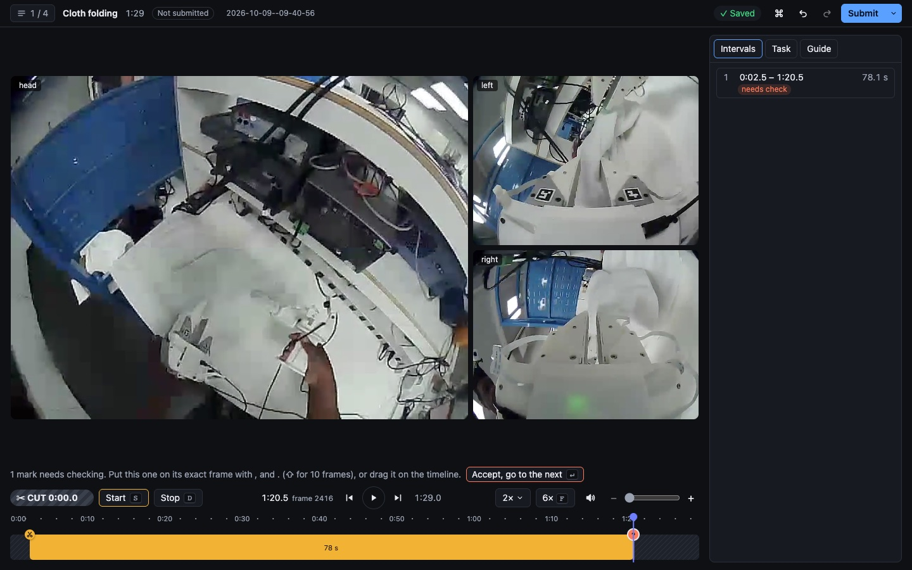

# video_annotation_tool

A browser tool for marking which parts of untrimmed, multi-camera robot recordings to **keep**, fast and frame-exact.

Annotators watch at 2× and press **S** (or click **Start**) where a task starts and **D** (**Stop**) where it stops. Marks made while the video plays land late by the annotator's reaction time, so they show as *needs check* and a **check pass** visits each of them: the video stops on the mark, and `,` `.` (or a drag on the zoomed-in timeline) put it on the exact frame. **⌘↵** (or **Submit**) saves and the next recording, already fetched, opens at once. Each recording produces one JSON file of kept intervals in source-clock nanoseconds, so the same cuts apply to every synchronized stream.



*The 89-second cloth-folding example: the head camera large with the two gripper cameras beside it, the kept interval on the right; below, the check pass on the live Stop mark, the transport row and the timeline, the kept interval in yellow.*

Why this design, in short: keystrokes at speed instead of Start/Stop buttons (a key press costs ~0.3 s and the eyes stay on the video), keys that **set** a state rather than toggle it (a double press changes nothing, so one slip never inverts the rest of the recording), and precision moved into a separate pass instead of watching at 1× with the mouse. The reasoning and the estimates behind it are in [docs/design.md](docs/design.md); the speed gains are still to be measured.

## Quickstart

Needs Node 24+, pnpm 10, ffmpeg (optional: timestamp checks and thumbnails) and Google Chrome or Microsoft Edge to annotate.

```bash
pnpm install
pnpm ingest ~/Downloads/recordings   # checks every recording, builds thumbnails, reads the task guides
pnpm dev                                                            # then open http://127.0.0.1:5173
```

`pnpm ingest` takes the folder holding the downloads: each recording is a folder with `manifest.json`, the `*-frames.csv` files and `videos/` (the frames and manifest may also sit in an `annotation-data/` folder beside `videos/`). The recordings in it are never modified; ingest writes `derived/catalog.json` (`--out` moves it, but never into the data folder) and reports any recording it rejects. Annotations are saved in `annotations/`, telemetry in `telemetry/events.jsonl`. Who is annotating is set with `--annotator <id>` (e.g. `pnpm dev --annotator ana`; default `local`) and recorded with every save and every telemetry event. For a production build: `pnpm build && pnpm start`.

**Task guides** are Markdown files in [`tasks/`](tasks), one per task: what to keep and how to tell where it starts and stops. Here they are the two tasks of the example recordings, [cloth folding](tasks/cloth-folding.md) and [cable plugging](tasks/cable-plugging.md). A short header lists the recordings each guide covers (`recordings: 2026-10-09--*`), and the tool shows the matching guide in the Task tab and stamps its version on every save. To change a task's rules, edit `tasks/<task>.md` and reload; re-run `pnpm ingest` only if you change its `recordings:` line (`--tasks <folder>` reads the guides from another folder). Annotators read the guides in the app but can't change them. [docs/task-guide-template.md](docs/task-guide-template.md) shows how to write a new one. How to use the tool itself is in the Guide tab, written in [src/web/guide.md](src/web/guide.md).

## Controls

**⌘K** (or **H**, or the ⌘ button at the top) opens the command menu: every command with its keys, searchable. The keys:

| Key | Does |
|---|---|
| **Space** | Play / pause |
| **S** · **D** | Start here (keep from this frame) · stop here (cut from this frame); no change if already so |
| **Enter** | Check: go to the next mark that needs it; on a mark, accept it and go on |
| **⌘Z** · **⇧⌘Z** | Undo · redo (unlimited; a drag or a held nudge is one step) |
| **⌘↵** | Submit and open the next recording (asks first if marks still need checking, the last interval never stops, or nothing is kept) |
| **←** **→** (⇧ for 10) | Step one frame (pauses) |
| hold **F** | Skim at 6× (or hold the **6×** button) |
| **[** **]** | Previous · next boundary |
| **⌘+** **⌘−** **⌘0** | Zoom the timeline in · out · to the whole recording |
| **,** **.** (⇧ for 10) | Move the selected boundary one frame |
| **Backspace** (or **Delete**) | Delete the selected interval, or else the selected boundary |
| **N** | No useful task (cut everything; asks first) |
| **Q** | Needs review: a reason (1–4) and a note |

On a Windows or Linux keyboard ⌘ is Ctrl. Everything also works with the mouse alone: **Start**, **Stop**, play, the speed list and **6×** (skims while held) sit above the timeline; **Check the next mark** does the check pass; **Submit** (*No useful task* and *Needs review* are in the menu beside it), undo and redo are at the top. On the timeline, click to jump (a click on an interval selects it), drag an interval's edge to move it, click a boundary's badge to delete it, right-click an interval to merge or delete it, and pinch or ⌘-scroll to zoom. A click on a gripper camera shows it large; marks are always saved on the head camera's frames.

## Saved format

`annotations/<recording_id>.json` holds exactly the requested contract:

```json
{
  "recording_id": "synthetic-a",
  "reference_video": "videos/head-0000.mp4",
  "status": "complete",
  "keep_intervals": [{ "start_ns": "3001939964140", "end_ns": "3007028294990" }],
  "notes": ""
}
```

- Times are the reference camera's `source_ts_ns` as decimal strings (they are never JavaScript numbers anywhere in the code). Intervals are `[start, stop)`: `start_ns` is the first kept frame, `end_ns` the first frame not kept, or the last frame plus 1 ns when an interval runs to the end of the video.
- `status` is `complete`, or `needs_review` with the reason and note in `notes`; `not_reviewed` while it is a draft (autosaved). "No useful task" is `complete` with no intervals. **Submit anyway** saves `complete` even with live marks never checked; the sidecar lists them as unchecked.
- Beside it, `<recording_id>.meta.json` keeps what the contract doesn't: every boundary with how it was set and whether it was checked, where to resume, effort (active and wall time, edits, undos), the revision and who saved it with which version of the task guide. `annotations/.history/<recording_id>/` keeps every saved revision, and a load finishes a save that a crash cut short from it; to start a recording over, delete its two files and that folder.

## Measuring speed without losing accuracy

Speed is the **real-time factor**: active time (page visible, and the annotator playing or using the keyboard or mouse within the last 30 s) divided by the recording's length, plus the **seconds spent per checked boundary**, which is where the time goes on boundary-dense recordings. Accuracy is boundary error against a gold annotation. The tool computes both and never blends them: accuracy is a floor, speed is what to improve above it.

```bash
pnpm score gold/ annotations/        # gold/ holds trusted <recording_id>.json files
```

prints, per recording: start and stop error in frames (median, p90 and signed bias, kept apart because stops are harder), missed, extra, merged and split intervals, seconds of footage kept or cut by mistake, the real-time factor and the seconds per check; a last row gives the errors, the real-time factor and the check times over all recordings. Only completed annotations are scored; files that break the contract are named and not scored, and `pnpm score` then exits 1. How this runs for 100 annotators (hidden gold, double annotation, thresholds per task) is in [docs/scaling.md](docs/scaling.md).

## Tests

```bash
pnpm lint                 # Biome, a lint rule that keeps nanoseconds out of Numbers, and TypeScript
pnpm test                 # unit and property tests (fast-check)
pnpm test:e2e             # Playwright in Chrome on generated clips whose frames show their index
pnpm build && pnpm perf   # the longest real recording, 320 test boundaries, 2×: must draw at 60 fps
```

The end-to-end tests need ffmpeg: they generate small variable-frame-rate clips in which every frame carries its index as a barcode, so a test can check which frame the browser really shows. Apart from this README's screenshot, no company data is in the repository; with `RECORDINGS_DIR` set to the downloads folder, `pnpm test` also checks ingest and timestamps on the real recordings.

## Limitations

- Marking needs Chrome or Edge: only they report each presented video frame reliably. Other browsers can watch.
- A mark made during playback is the last frame the browser reported showing: in test runs it was up to 3 frames behind the picture, never ahead (the end-to-end test allows up to 5). That is why live marks *need a check* and the check pass exists; marks made while paused are exact.
- With a gripper camera shown large, a mark is still the head camera's frame, but the large picture is only kept within 0.25 s × speed of it (after falling behind it may run up to 0.5 s × speed ahead), so a live mark judged on it can land that much early or late; on the test clips it stayed within 6 frames.
- Single-part camera videos only (none of the recordings has more); the data model already supports parts.
- One local annotator per server: leases, review queues and dashboards are described in [docs/scaling.md](docs/scaling.md), not built.
- No automatic start/stop detection or suggestions, by request: annotators decide from the video, following the task's guide ([template](docs/task-guide-template.md)).

## Layout

| Path | What lives there |
|---|---|
| `src/core/` | Pure TypeScript: frame maps, the keep/cut timeline, undo history, export, scoring. No DOM or Node APIs. |
| `src/server/` | The local server: ingest, media with byte ranges, annotation saves with revisions, telemetry, the score report. |
| `src/web/` | The React UI: player, timeline, check pass, queue, saving. |
| `scripts/` | `ingest`, `score` and `perf`. |
| `tasks/` | The task guides, one Markdown file per task. |
| `tests/` | Unit, property and end-to-end tests on synthetic data, plus the opt-in checks on the real recordings. |
| `docs/` | [Design](docs/design.md), [scaling](docs/scaling.md), a [task guide template](docs/task-guide-template.md). |
