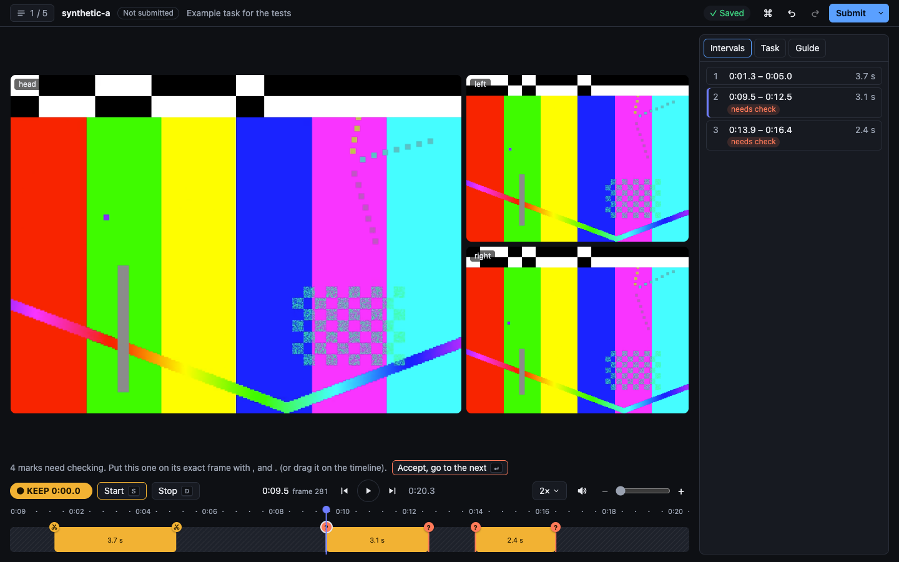

# video_annotation_tool

A browser tool for marking which parts of untrimmed, multi-camera robot recordings to **keep**, fast and frame-exact.

Annotators watch at 2× and press **S** where a task starts ("keep from here") and **D** where it stops ("cut from here"). Marks made while the video plays land late by the annotator's reaction time, so a short **check pass** then visits each of them: the video stops on the mark, a filmstrip shows the 1.5 s before it, and one key or click puts it on the exact frame. **⌘↵** saves and the next recording, already fetched, opens at once. Each recording produces one JSON file of kept intervals in source-clock nanoseconds, so the same cuts apply to every synchronized stream.



*A synthetic test clip (the tests' own footage): the reference camera with the two gripper cameras, kept intervals and the guideline on the right; below, the check pass, the whole-recording overview and twenty seconds around the playhead.*

Why this design, in short: keystrokes at speed instead of Start/Stop buttons (a key press costs ~0.3 s and the eyes stay on the video), keys that **set** a state rather than toggle it (a double press changes nothing, so one slip never inverts the rest of the recording), and precision moved into a separate, cheap pass instead of watching at 1× with the mouse. The reasoning and the measured numbers are in [docs/design.md](docs/design.md).

## Quickstart

Needs Node 24+, pnpm 10, ffmpeg (optional: timestamp checks and thumbnails) and Google Chrome or Microsoft Edge to annotate.

```bash
pnpm install
pnpm ingest ~/Downloads/recordings   # finds and checks every recording, builds thumbnails
pnpm dev                             # then open http://127.0.0.1:5173
```

`pnpm ingest` takes the folder holding the downloads: each recording is a folder with `manifest.json`, the `*-frames.csv` files and `videos/` (the frames and manifest may also sit in an `annotation-data/` folder beside `videos/`). Nothing in it is ever modified; ingest writes `derived/catalog.json` and reports any recording it rejects. Annotations are saved in `annotations/`, telemetry in `telemetry/events.jsonl`. For a production build: `pnpm build && pnpm start`.

## Controls

The keys needed on day one are always on screen as buttons; **H** shows the rest.

| Key | Does |
|---|---|
| **Space** | Play / pause |
| **S** · **D** | Keep from here · cut from here (no change if already so) |
| **Enter** | Check pass: go to the next rough mark; on a mark, accept it and go on |
| **⌘Z** · **⇧⌘Z** | Undo · redo (unlimited; a drag or a held nudge is one step) |
| **⌘↵** | Submit and open the next recording |
| **←** **→** (⇧ for 10) | Step one frame (pauses) |
| **A** | Back 2 s |
| **1** **2** **3** **4** | Speed 1× · 1.5× · 2× · 2.5× (kept between recordings) |
| hold **F** | Skim at 4× |
| **[** **]** | Previous · next boundary |
| **,** **.** (⇧ for 10) | Move the selected boundary one frame |
| **T** | Move the nearest boundary to the playhead |
| **X** | Flip keep/cut for the stretch under the playhead |
| **Backspace** | Delete the selected boundary |
| **/** | Replay a second either side of the selected boundary at half speed |
| **N** | No useful task (cut everything; asks first) |
| **Q** | Needs review: a reason (1–4) and a note |

On a Windows or Linux keyboard ⌘ is Ctrl. The mouse works too: drag boundary handles, click filmstrip frames, hover the overview for thumbnails.

## Saved format

`annotations/<recording_id>.json` holds exactly the requested contract:

```json
{
  "recording_id": "synthetic-a",
  "reference_video": "videos/head-0000.mp4",
  "status": "complete",
  "keep_intervals": [{ "start_ns": "3001939964140", "end_ns": "3007028294990" }],
  "notes": ""
}
```

- Times are the reference camera's `source_ts_ns` as decimal strings (they are never JavaScript numbers anywhere in the code). Intervals are `[start, stop)`: `start_ns` is the first kept frame, `end_ns` the first frame not kept, or the last frame plus 1 ns when an interval runs to the end of the video.
- `status` is `complete`, or `needs_review` with the reason and note in `notes`; `not_reviewed` while it is a draft (autosaved). "No useful task" is `complete` with no intervals.
- Beside it, `<recording_id>.meta.json` keeps what the contract doesn't: every boundary with how it was set and whether it was checked, where to resume, effort (active and wall time, edits, undos), the revision and who saved it with which guideline. `annotations/.history/<recording_id>/` keeps every saved revision.

## Measuring speed without losing accuracy

Speed is the **real-time factor**: active time (page visible, and the annotator playing or using the keyboard or mouse within the last 30 s) divided by the recording's length, plus the **seconds spent per checked boundary**, which is where the time goes on boundary-dense recordings. Accuracy is boundary error against a gold annotation. The tool computes both and never blends them: accuracy is a floor, speed is what to improve above it.

```bash
pnpm score gold/ annotations/        # gold/ holds trusted <recording_id>.json files
```

prints, per recording and in total: start and stop error in frames (median, p90 and signed bias, kept apart because stops are harder), missed, extra, merged and split intervals, seconds of footage kept or cut by mistake, the real-time factor and the seconds per check. Only completed annotations are scored. How this runs for 100 annotators (hidden gold, double annotation, thresholds per task) is in [docs/scaling.md](docs/scaling.md).

## Tests

```bash
pnpm lint                 # Biome, a lint rule that keeps nanoseconds out of Numbers, and TypeScript
pnpm test                 # unit and property tests (fast-check)
pnpm test:e2e             # Playwright in Chrome on generated clips whose frames show their index
pnpm build && pnpm perf   # the longest real recording, 320 boundaries, 2×: must draw at 60 fps
```

The end-to-end tests need ffmpeg: they generate small variable-frame-rate clips in which every frame carries its index as a barcode, so a test can check which frame the browser really shows. No company data is in the repository.

## Limitations

- Marking needs Chrome or Edge: only they report each presented video frame reliably. Other browsers can watch.
- A mark made during playback is the last frame the browser reported showing; it trails the picture by 0–3 frames (measured). That is why live marks are "rough" and the check pass exists; marks made while paused are exact.
- Single-part camera videos only (none of the recordings has more); the data model already supports parts.
- One local annotator per server: leases, review queues and dashboards are described in [docs/scaling.md](docs/scaling.md), not built.
- No automatic start/stop detection or suggestions, by request: annotators decide from the video, following the batch's guideline ([example](docs/guidelines-example.md)).

## Layout

| Path | What lives there |
|---|---|
| `src/core/` | Pure TypeScript: frame maps, the keep/cut timeline, undo history, export, scoring. No DOM or Node APIs. |
| `src/server/` | The local server: ingest, media with byte ranges, annotation saves with revisions, telemetry, the score report. |
| `src/web/` | The React UI: player, timelines, check pass, queue, saving. |
| `scripts/` | `ingest`, `score`, `perf` and `demo` (plays the demo steps in a Chrome window). |
| `tests/` | Unit, property and end-to-end tests, all on synthetic data. |
| `docs/` | [Design](docs/design.md), [scaling](docs/scaling.md), an [example guideline](docs/guidelines-example.md). |
