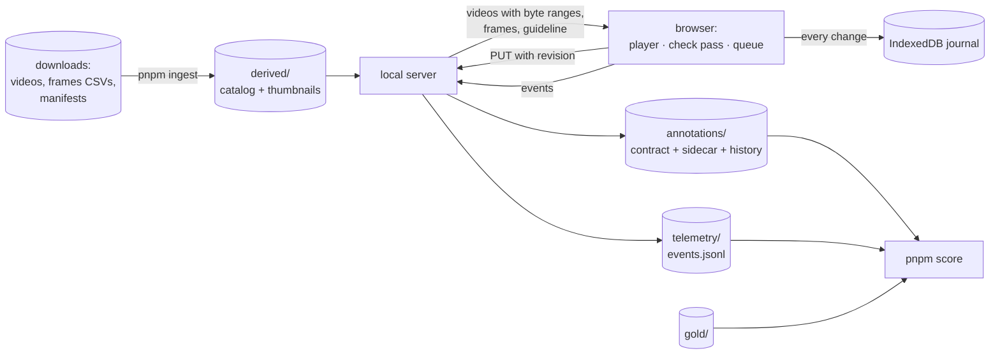

# Design

The job: hired annotators mark the **KEEP** intervals `[start, stop)` of untrimmed robot-demonstration recordings (a head camera and two gripper cameras, about 30 fps with a variable frame rate) and save one JSON file per recording. It is graded on speed, clear boundaries, easy recovery from mistakes and how quickly people learn it; with 100 annotators, data annotated per hour is what matters.

## The interaction: mark while watching, then check the cuts

1. **Mark at speed.** The video plays at 2× (1–2.5× per annotator, sticky). **S** means "keep from here", **D** "cut from here". They *set* a state: S while already keeping does nothing, so a double press or a missed press never inverts the rest of the recording (the "mutually exclusive, exhaustive" coding model of Noldus Observer XT). Hold **F** to skim obvious downtime at 4×.
2. **Check the cuts.** A mark made during playback is stored where the key was pressed and is *rough*: reaction time puts it late, and at 2× the delay doubles in frames (a key press in a fast stream lands ~0.38 s late, about 22 frames at 2×). Nothing is shifted silently. **Enter** visits each rough mark: the video stops on it, a filmstrip shows 1.5 s before and 0.5 s after (where the true boundary usually is), `,` `.` move it a frame, a click on a frame puts it there, **/** replays the moment at half speed, and **Enter** accepts it and goes on. Marks made while paused are exact and skip the pass.
3. **Submit and move on.** **⌘↵** checks that no rough mark is left, asks if the last interval runs to the end of the video, saves, and opens the next recording, prefetched while this one was being annotated (about 60 ms in the end-to-end tests).

Why this split rather than Start/Stop buttons at 1×:

| | Start/Stop buttons | Mark while watching + check |
|---|---|---|
| Watching | 1×, pause to click | 2×, never paused |
| Per boundary | ~1.3 s to point and click, eyes leave the video | ~0.3 s key press, eyes stay on the video |
| Precision | scrubbing back and forth | one guided look (~2–5 s) |
| 72 s folding clip | ~100 s | ~50 s |
| 42 min session, ~320 boundaries | ~50–60 min | ~32–48 min |

The time estimates come from published key-press and pointing costs and are to be measured: the tool logs what is needed (below). Two choices follow from the evidence: never mark at 3× or more (referees' correct decisions fell from 89% to 82% to 75% at 1×, 2× and 3×), and give stops extra care (people detect presence far better than absence, so "the task has ended" is the harder call; the score report keeps start and stop errors apart).

The key set stays small: the day-one keys (play, S, D, Enter, undo, submit, help) are always on screen as buttons, the rest behind **H**. Large shortcut sets are what made older annotation tools slow to learn.

## The timeline model

A recording's annotation is an ordered list of **boundaries**, each `{frame, state: keep | cut, origin, checked}`; everything before the first is cut, and position `frameCount` is END, just after the last frame. Every edit is a pure function returning a new timeline (or the same object when nothing changed, so undo never records an empty step):

- S and D set a state from a frame on; a boundary whose state equals the one before it is a *through* boundary, drawn dashed and dropped from the output. Keeping it makes later edits local: deleting the boundary that made it redundant brings it back into effect.
- Moves (nudge, drag, filmstrip click, T) are clamped between the neighbours, so the order never changes. Choosing the frame a rough mark already sits on confirms it.
- Undo is unlimited, over immutable snapshots; a drag or a held nudge is one step.

Export maps frames to the reference camera's source timestamps: `start_ns` is the first kept frame, `end_ns` the first frame not kept, or the last frame + 1 ns at the end of the video. Nanoseconds are `BigInt` and decimal strings throughout; a Biome lint rule rejects any `Number(...)` of a nanosecond value, and one audited function converts a duration to seconds for display. `src/core` is pure TypeScript with no DOM or Node types (its own `tsconfig` enforces it), so every rule is unit- and property-tested with fast-check.

## Frame accuracy

"Which frame is on screen" comes from one place, `FrameClock`, built on `requestVideoFrameCallback`: each presented frame's media time is mapped through the frames CSV ("last presentation time ≤ t"), never through `currentTime`, which trails the picture during playback. Seeks aim slightly inside a frame (its presentation time + min(1 ms, half the gap to the next)), because Chrome truncates seek times to whole microseconds and would show the previous frame for ~2% of frames; every seek is verified against the next frame callback and retried once. One seek is in flight at a time and the newest request wins, so five quick → presses move exactly five frames. On pause, the player snaps to the frame actually on screen.

Measured with barcoded test clips: 200 of 200 marks made while paused save exactly the frame shown. During 2× playback a mark saves the last frame the browser reported presenting, which trails the picture by 0–3 frames, never ahead; no browser API reports a frame earlier than that, which is the other reason live marks are rough. Firefox and Safari present frames ahead of their callbacks during playback, so marking is limited to Chrome and Edge.

## Saving and recovery

- Every change goes to an IndexedDB **journal** at once (strict durability; Chrome's default can lose the last writes in a crash) and to the server after 300 ms of quiet, never more than 2 s later. The save chip says "Saving…" as soon as a change waits.
- The server writes atomically (temp file, fsync, rename, directory fsync), keeps every revision, and refuses a save based on an old revision (412). A second tab on the same recording therefore stops with a conflict instead of overwriting.
- After a crash the journal is reopened if it builds on what the server has — including when the save that was in flight landed but the page died before hearing so — and otherwise the server's version wins and the annotator is told.
- Each recording's annotation (editor, undo history, saver) lives as long as the page, so going back to a recording keeps its undo history; the toast after "no useful task" can undo it. Keys stay off from an outcome until the next recording is on screen, so nothing typed in between lands on the wrong one.

## Measurement

The page logs one event stream (opened, media ready, play/pause and speed, every kind of edit, save outcomes, a heartbeat every 15 s, and a summary per submitted task). Edit events are derived from the editor's actions in one place rather than from each control. The check pass is timed per boundary: from landing on a rough mark to the Enter that leaves it, however the mark was moved meanwhile. Active time counts only while the recording is on screen and the page visible, and stops 30 s after the last input unless the video plays. `pnpm score` turns this, a gold folder and the annotations into the report described in the README. Speed and accuracy are reported side by side, never as one score.

## What the tool does not do, on purpose

- **No automatic detection or suggested boundaries**: ruled out by the company, and suggestions invite over-trust. The tool knows only keep and cut.
- **No task rules in code.** What counts as a task is the batch's guideline, a Markdown file shown beside the video and stamped (by its hash) on every save; the tool never interprets it. Links like `#<recording>/<frame>` in it open that moment. See the [example](guidelines-example.md).
- **No sensor signal lanes** (the annotators work from the video; signal plots cost time per action), **no reaction-time compensation** (live marks are checked visibly instead), **no per-interval outcome labels** (an easy extension if wanted).
- **Not built yet:** leasing, review queues and dashboards for many annotators ([scaling](scaling.md)); a break prompt and "annotated up to" progress on long sessions; a player for multi-part videos (the model and export already handle parts).

## Decisions made while building

- Boundary handles on the detail timeline are pointer-only. They were planned as ARIA sliders, but a slider that keyboard users cannot operate is worse than none; boundaries move from the keyboard with `,` `.` and T.
- **/** plays around a boundary once and comes back to it (press again to replay) rather than looping.
- The server's byte-range support is checked from the browser (the path the video takes) instead of at server start.
- The detail timeline canvas, redrawn with every frame, gets its own compositor layer: without it, its repaints made the video drop about a fifth of its frames at 2× on the long recording (`pnpm perf` now fails if that comes back).
